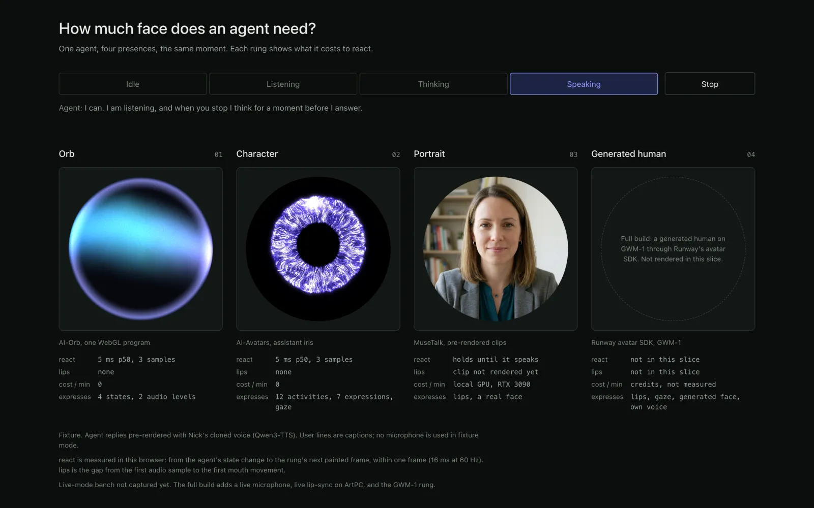
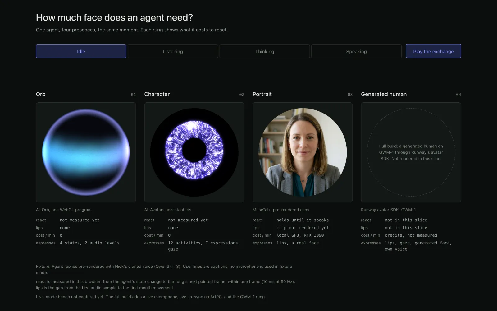
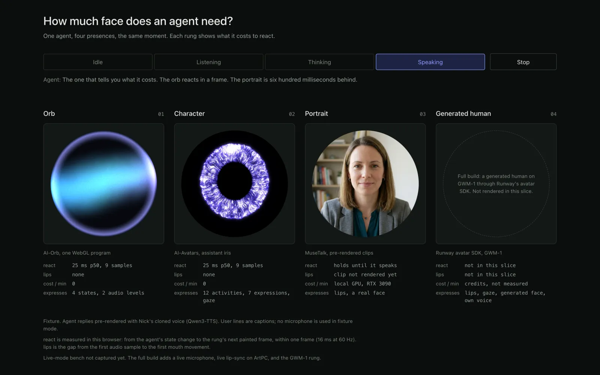

# Presence ladder

**How much face does an agent need?**



**Live:** https://presence-ladder.vercel.app

One agent, four presences, the same moment. The same agent state is rendered side by side as an orb, a character with eyes, a lip-synced portrait, and a generated human. Under each rung a small readout shows what it costs to react: milliseconds, compute, and what it can and cannot express.

Three of the rungs come from my own earlier work:

| Rung | Source | In this slice |
|---|---|---|
| 01 Orb | [AI-Orb](https://github.com/weeeha/AI-Orb), one WebGL program, audio-reactive | live, vendored in `vendor/ai-orb` |
| 02 Character | [AI-Avatars](https://github.com/weeeha/AI-Avatars), 50 characters for a round display; this page uses the assistant iris | live, runtime copied to `public/avatars` |
| 03 Portrait | MuseTalk lip-sync, the "presence C" path from my interview simulator | still portrait; pre-rendered clips land when they are rendered |
| 04 Generated human | Runway's avatar SDK on GWM-1 | not in this slice; the tile says so |

## Modes

- **Fixture** (this deploy): a scripted exchange plays. User lines are captions. Agent replies are pre-rendered with my cloned voice (Qwen3-TTS) and played through a real `AudioContext`, so every level and stream a rung sees is real audio. No keys, no microphone.
- **Live** (full build): a microphone, a live agent through Runway's SDK, live lip-sync on a local GPU. Not deployed.

## What is measured

- **react**: from the agent's state change to the rung's next painted frame, measured in your browser, within one frame.
- **lips**: from the first audio sample to the first mouth movement. "none" when the rung has no mouth.
- **cost / min** and **expresses** are facts about each renderer, not measurements.

Nothing on the page is a fallback shown as live. A rung that cannot render says so in its readout.

## Run

```sh
pnpm install
pnpm dev          # http://localhost:3000
pnpm vitest run   # store, metrics, fixture schedule
pnpm tsc --noEmit
```

## Layout

```
app/            page and layout
components/     ladder view, state strip, tile, HUD
rungs/          one component per rung
lib/            agent source interface, fixture source, ladder store, metrics
fixture/        exchange.json and the agent WAVs (public/fixture)
public/avatars/ AI-Avatars runtime, copied as-is
vendor/ai-orb/  AI-Orb sources, copied as-is
```

## Screenshots



Idle, before the exchange plays.



Third agent reply, with the measured react time per rung.

Spec and plan: `Runaway/builds/12-presence-ladder` in my prep workspace.
